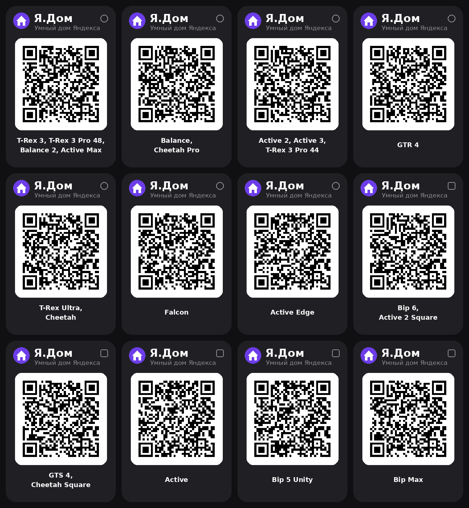

# Я.Дом — Умный дом Яндекса на часах Amazfit

Мини-приложение для Zepp OS: комнаты, свет (яркость и цвет), розетки, климат,
датчики (протечка, температура, открытие), сценарии и ТВ-пульт через сценарии.
Работает через официальный API Умного дома Яндекса.

## Установка

1. В приложении Zepp включите режим разработчика:
   Профиль → Настройки → О приложении → 7 раз тапнуть по логотипу.
2. Профиль → ваши часы → Режим разработчика → значок сканера.
3. Отсканируйте QR для своей модели часов (круг — круглый экран, квадрат — квадратный).

## Токен Яндекса

1. https://oauth.yandex.ru → «Создать приложение» → «Для авторизации пользователей».
2. Платформа «Веб-сервисы», Redirect URI: `https://oauth.yandex.ru/verification_code`
3. Доступы: Умный дом → `iot:view`, `iot:control`.
4. Откройте `https://oauth.yandex.ru/authorize?response_type=token&client_id=ВАШ_CLIENT_ID`,
   разрешите доступ, скопируйте токен (`y0_...`).
5. Zepp → часы → Приложения → «Я.Дом» → Настройки → вставьте токен.

## ТВ-пульт

Если телевизор добавлен как «свой пульт», создайте в «Доме с Алисой» сценарии:
«ТВ Вкл», «ТВ Выкл», «ТВ Громче», «ТВ Тише», «ТВ Звук», «ТВ Вверх», «ТВ Вниз»,
«ТВ Лево», «ТВ Право», «ТВ Ок», «ТВ Вход» — они появятся на экране пульта.

## Важно

- Часы выходят в интернет через телефон: Zepp должен быть запущен.
- Режим «Не беспокоить» на часах может блокировать связь.
- Подходит для часов на Zepp OS 3.0 и новее (см. подписи на карточках).

## Контакты

Вопросы и предложения — в Telegram: [@Boiko_Ivan](https://t.me/Boiko_Ivan)
